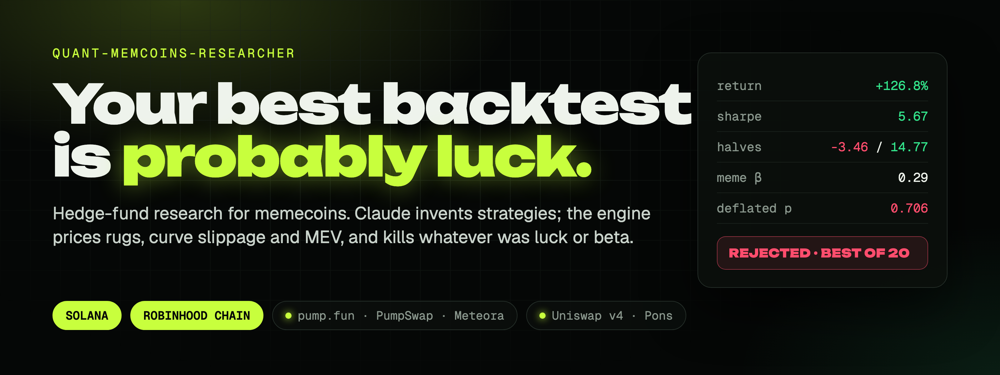
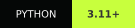
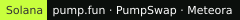
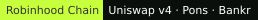
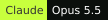
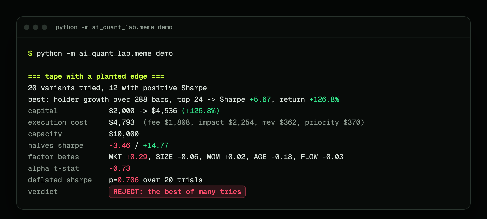
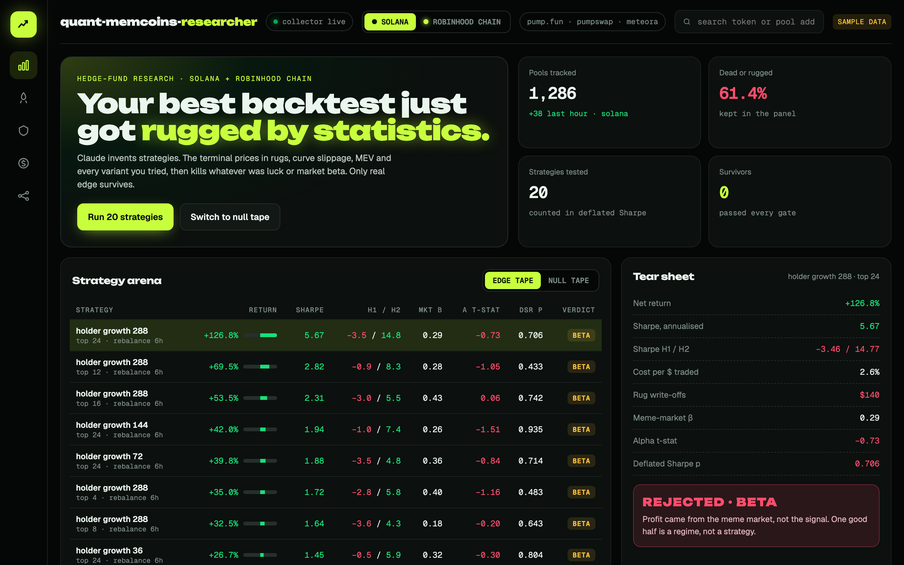
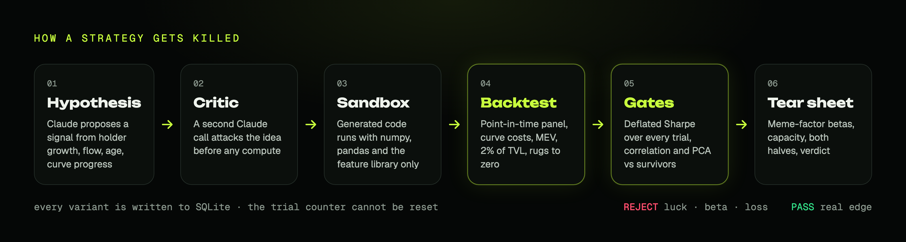
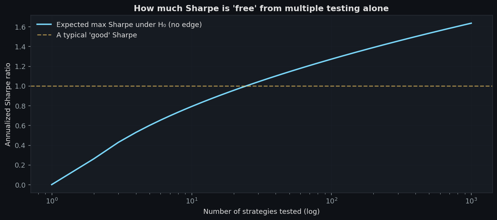
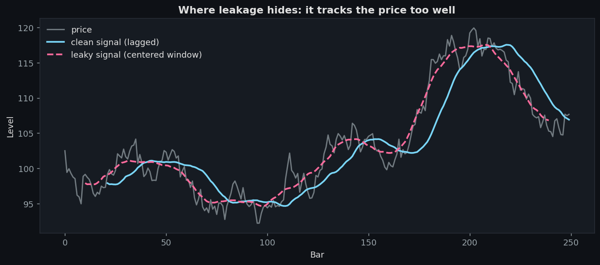

<p align="center">
  
</p>

<p align="center">
  <a href="https://github.com/zostaff/quant-memcoins-researcher/actions/workflows/ci.yml"></a>
  
  
  <a href="LICENSE"></a>
</p>
<p align="center">
  
  
  
</p>

<p align="center">
  <b>The research stack a hedge fund would use, pointed at memecoins.</b><br>
  Claude invents strategies. The engine prices in rugs, curve slippage and MEV,<br>
  counts every variant you tried, and kills whatever was luck or market beta.
</p>

<p align="center">
  <a href="https://zostaff.github.io/quant-memcoins-researcher/"><b>Website</b></a> ·
  <a href="#-the-demo">Demo</a> ·
  <a href="#-what-it-does">What it does</a> ·
  <a href="#-chains">Chains</a> ·
  <a href="#-quick-start">Quick start</a> ·
  <a href="#-how-it-works">How it works</a> ·
  <a href="docs/MEMECOIN.md">Docs</a>
</p>

<br>

## ⚡ The demo

**+127% in a backtest. Rejected anyway.**

<p align="center"></p>

Twenty strategy variants run on two synthetic tapes, no API key needed.

- **No edge in the tape:** all 20 lose money. The best one turns $2,000 into
  $265 after $1,655 of fees, price impact, MEV and priority fees.
- **A planted edge:** the best variant makes +126.8% with Sharpe 5.67, and the
  system still says no. The first half loses money, 0.29 of the return is
  meme-market beta, alpha is not significant, and the deflated Sharpe says
  the best of 20 random tries would look this good anyway.

The profit was the market, not the signal. That is the mistake this tool exists to catch.

```bash
python -m ai_quant_lab.meme demo      # about a minute
```

<br>

## 🧬 What it does

Every tool a fund uses to stop fooling itself, rebuilt for a market where most tokens die within a day.

| | Memecoin backtests usually… | Here instead |
|:--:|---|---|
| 🪦 | test only tokens that are alive today | **Point-in-time universe.** Pools are recorded the moment they launch; dead tokens stay in the panel and a rug while held is written off to zero |
| 💧 | guess slippage at a flat 1% | **Exact curve cost.** Constant-product loss `1 - (1-f)·Q/(Q+s)` per trade, plus priority fee, MEV haircut and the real Uniswap fee tier of each pool |
| 🐋 | trade size the pool cannot absorb | **Participation cap.** A position is at most 2% of pool TVL; the book rebalances only past a 25% drift |
| 📈 | call +120% alpha | **Alpha vs beta.** Meme factors MKT, SIZE, MOM, AGE and FLOW, rugs included, and an OLS split of signal vs market |
| 🏦 | assume it scales | **Capacity curve.** The same weights at $1k, $10k, $100k and $1M; capacity is where return on capital halves |
| 🎰 | keep the best of 50 tries | **Deflated Sharpe.** Every variant is written to SQLite, and significance is paid for with the honest trial count |
| 🚩 | ignore who holds the supply | **Rug screen.** Holders, top-10 wallet share, mint and freeze authority, bonding-curve progress, all point-in-time |

Everything ends in one **tear sheet**: costs broken down, factor betas, capacity, both halves, deflated Sharpe, and a verdict.

<p align="center"></p>
<p align="center"><sub>Dashboard concept with sample data. The engine itself is a Python library and CLI.</sub></p>

<br>

## ⛓️ Chains

| |  |  |
|---|---|---|
| **Venues** | pump.fun, PumpSwap, Meteora | Uniswap v4 / v3, Pons, Bankr |
| **Pool fee** | 1% default | read from each pool's fee tier: 1%, 0.3%, 0.01% |
| **Per-transaction cost** | priority fee + tip | L2 gas in ETH |
| **MEV** | sandwiches are common | sequencer, no public mempool |
| **Token fields** | holders, top-10, mint / freeze, curve progress | holders, top-10, Pons curve progress |

Data comes from the free GeckoTerminal API, and one database holds both chains.
Cost presets are placeholders: calibrate them on your own fills.

<br>

## 🚀 Quick start

```bash
git clone https://github.com/zostaff/quant-memcoins-researcher
cd quant-memcoins-researcher
python3 -m venv .venv && source .venv/bin/activate
pip install -e ".[dev]"
cp .env.example .env          # ANTHROPIC_API_KEY, only needed for `research`
```

```bash
python -m ai_quant_lab.meme demo                        # tear sheets, no key, no data
python -m ai_quant_lab.meme run  --db data/meme.db      # collect Solana + Robinhood Chain, keep running
python -m ai_quant_lab.meme info --db data/meme.db      # what has been collected
python -m ai_quant_lab.meme research --db data/meme.db --network robinhood --iterations 20
```

| Command | |
|---|---|
| `demo` | Tear sheets on synthetic tapes, no API key or data needed |
| `collect` | Register new pools and snapshot the tracked ones |
| `backfill` | Pull 5-minute candles for collected pools |
| `run` | Collect and refresh the stalest candles on every chain, forever |
| `info` | Pools, candles and token fields per chain |
| `research` | Claude proposes strategies on the collected panel; the gates decide |

> [!NOTE]
> The free API allows about 30 calls a minute, so the collector needs to run for
> days before there is history worth researching. A launchd template is in [`deploy/`](deploy/).

<br>

## 🔬 How it works

<p align="center"></p>

1. **Hypothesis.** Claude proposes a signal from volume and holder growth, liquidity, age, curve progress and the rug screen.
2. **Critic.** A second Claude call attacks the idea before any compute is spent.
3. **Sandbox.** Generated code is AST-checked and runs with numpy, pandas and the feature library only.
4. **Backtest.** Long-only on the point-in-time panel with curve costs, the participation cap, the rebalance band and rug write-offs.
5. **Gates.** Deflated Sharpe over the honest trial count, then correlation and PCA checks against the strategies already accepted. No overrides.
6. **Tear sheet.** Meme-factor betas, capacity, both halves, verdict.

```python
from ai_quant_lab.meme import MemeBacktestConfig, costs_for_network, meme_backtest, tear_sheet

config = MemeBacktestConfig(costs=costs_for_network("robinhood"))
result = meme_backtest(weights, panel, config)          # long-only, rugs written off
sheet = tear_sheet(weights, panel, n_trials=memory.n_trials(), config=config)
print(sheet.summary())
```

Default model is Claude Opus 5.5, with prompt caching on the agents' system prompts.

<br>

## 🧱 The engine underneath

The memecoin layer ([`ai_quant_lab/meme/`](ai_quant_lab/meme/), about 1,800 lines)
sits on a general research engine that does not care which market it points at.

<details>
<summary><b>Deflated Sharpe and the multiple-testing tax</b></summary>
<br>



Run a thousand random strategies on a tape with no edge and the best one shows
an annualized Sharpe around 1.5. "We tried many things and the best one works"
means nothing until it is paid for with the trial count.
`examples/05_deflated_sharpe_demo.py` shows the gate killing the lucky best.
Methodology: [docs/VALIDATION.md](docs/VALIDATION.md).
</details>

<details>
<summary><b>Leakage detector, walk-forward and purged CV</b></summary>
<br>



Centered rolling windows, forgotten shifts and forward-looking labels used as
features are caught by comparing future and past correlations of every feature
with the target. Walk-forward and combinatorial purged CV give a distribution of
out-of-sample Sharpes instead of one lucky number.
</details>

<details>
<summary><b>Correlation and PCA gates, factor attribution, kill switch</b></summary>
<br>

A new strategy must not be a quiet copy of one already accepted: pairwise
correlation and PCA concentration both check for that. Accepted strategies get a
paper-trading slot with live diagnostics against the backtest distribution and a
kill switch on drawdown, daily loss and Sharpe collapse, which stays tripped
until reset by hand.
</details>

| Example | What it shows | Key |
|---|---|:--:|
| [`10_memecoin_multiple_testing.py`](examples/10_memecoin_multiple_testing.py) | Memecoin panel, many variants, the gate decides | — |
| [`05_deflated_sharpe_demo.py`](examples/05_deflated_sharpe_demo.py) | 1000 random strategies, the deflated Sharpe kills the best | — |
| [`03_leakage_demo.py`](examples/03_leakage_demo.py) | Forward reference vs centered rolling vs clean | — |
| [`09_cross_sectional_portfolio.py`](examples/09_cross_sectional_portfolio.py) | PCA gate finds duplication pairwise correlation misses | — |
| [`06_full_research_loop.py`](examples/06_full_research_loop.py) | End-to-end Claude loop | 🔑 |

<br>

## 🚧 What it does not do

- **It does not trade.** No wallet, no execution. It tells you whether a strategy is worth trading.
- **Costs are a model.** Constant product is exact for bonding curves and conservative for concentrated liquidity. Calibrate against real fills.
- **Free data has gaps.** Holder counts arrive late for fresh tokens, and GeckoTerminal does not report mint or freeze authority on EVM chains.
- **History has to be collected.** The panel only knows what the collector saw, from the moment it started.

<br>

## 📚 Docs

| | |
|---|---|
| [MEMECOIN.md](docs/MEMECOIN.md) | The memecoin layer, chains, data fields |
| [ARCHITECTURE.md](docs/ARCHITECTURE.md) | System design |
| [AGENTS.md](docs/AGENTS.md) | Agent prompts and behavior |
| [VALIDATION.md](docs/VALIDATION.md) | Statistical methodology |
| [CONTRIBUTING.md](docs/CONTRIBUTING.md) | Extending the system |

Built on [ai-quant-researcher](https://github.com/zostaff/ai-quant-researcher).

<br>

<p align="center">
  <b>Build slow. Validate hard. Trade small.</b><br>
  <sub>MIT licensed. Not investment advice. Memecoins go to zero; so can you.</sub>
</p>
