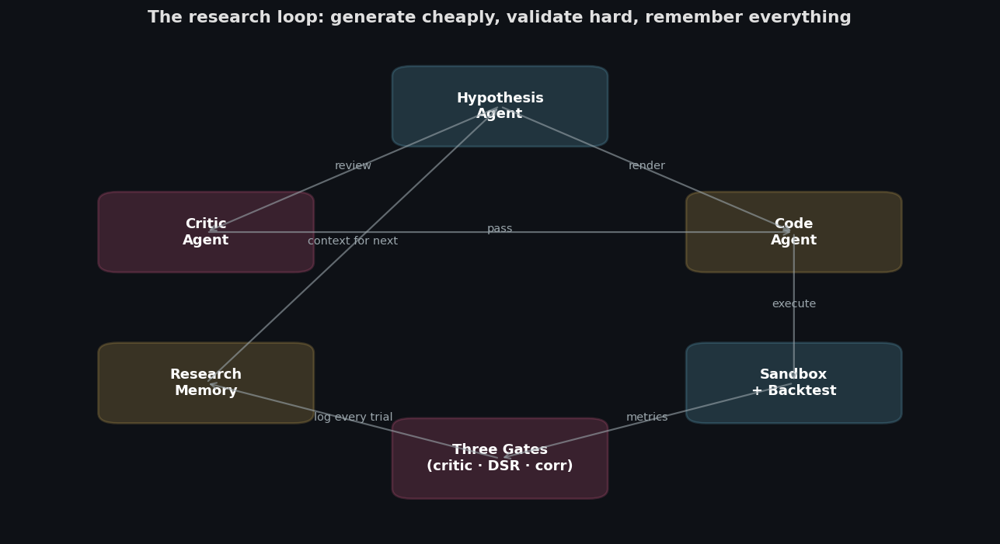

# quant-memcoins-researcher

[](https://github.com/zostaff/quant-memcoins-researcher/actions/workflows/ci.yml)
[](https://www.python.org/downloads/)
[](LICENSE)
[](tests/)
[](docs/MEMECOIN.md#networks)

> **Your best memecoin backtest is probably luck.**
> This is the research stack a hedge fund would use, pointed at pump.fun,
> PumpSwap, Meteora and Robinhood Chain. Claude invents strategies. The
> system prices in rugs, curve slippage and MEV, counts every variant you
> tried, and kills whatever was luck or market beta.


<sub>Dashboard concept with sample data. The engine itself is a Python library and CLI.</sub>

---

## What it does

| Problem with memecoin backtests | What the system does instead |
|---|---|
| Only tokens that are alive today get tested | **Point-in-time universe.** Pools are recorded the moment they launch. Dead tokens stay in the panel; a rug while you hold it is written off to zero |
| Slippage is a flat 1% guess | **Exact curve cost.** Constant-product loss `1 - (1-f)·Q/(Q+s)` per trade, plus priority fee and MEV haircut, with presets per chain and the real Uniswap fee tier per pool |
| Paper size ignores the pool | **Participation limit.** A position is capped at 2% of pool TVL, and the book only rebalances past a 25% drift |
| "It made +120%" | **Alpha vs beta.** Meme factors MKT, SIZE, MOM, AGE and FLOW, rugs included, and an OLS split of what came from the signal and what came from the market |
| It works with $1k | **Capacity curve.** The same weights run at $1k, $10k, $100k and $1M; capacity is where return on capital halves |
| You tried 50 variants and kept the best one | **Deflated Sharpe.** Every variant is counted in SQLite and the significance test is paid for with the honest trial count |
| The dev holds 60% of the supply | **Rug screen.** Holders, top-10 wallet share, mint and freeze authority, bonding-curve progress, all known only from the moment they were observed |

All of it ends in one tear sheet with a verdict.

---

## The demo: +127% and still rejected

```bash
python -m ai_quant_lab.meme demo      # synthetic tapes, no API key, about a minute
```

Twenty strategy variants run on two synthetic tapes.

On a tape with **no edge**, all 20 lose money. The best one turns $2,000 into
$265 after $1,655 of fees, price impact, MEV and priority fees.

On a tape with a **planted edge**, the best variant looks like a winner:

```
best: holder growth over 288 bars, top 24 -> Sharpe +5.67, return +126.8%
capital            $2,000 -> $4,536 (+126.8%)
execution cost     $4,793  (fee $1,808, impact $2,254, mev $362, priority $370)
capacity           $10,000
halves sharpe      -3.46 / +14.77
factor betas       MKT +0.29, SIZE -0.06, MOM +0.02, AGE -0.18, FLOW -0.03
alpha t-stat       -0.73
deflated sharpe    p=0.706 over 20 trials
verdict            REJECT: the best of many tries
```

It loses money in the first half, carries 0.29 of meme-market beta, has no
significant alpha, and does not beat what the best of 20 random tries would
show. The profit was the market, not the signal.

---

## Chains

| | Solana | Robinhood Chain |
|---|---|---|
| Venues | pump.fun, PumpSwap, Meteora | Uniswap v4 / v3, Pons, Bankr |
| Pool fee | 1% default | read from the pool's fee tier (1%, 0.3%, 0.01%) |
| Per-transaction cost | priority fee + tip | L2 gas in ETH |
| MEV | sandwiches common | sequencer, no public mempool |

Data comes from the free GeckoTerminal API. One database holds both chains.
Cost presets are placeholders; calibrate them on your own fills. Details in
[docs/MEMECOIN.md](docs/MEMECOIN.md).

---

## Quick start

```bash
git clone https://github.com/zostaff/quant-memcoins-researcher
cd quant-memcoins-researcher
python3 -m venv .venv && source .venv/bin/activate
pip install -e ".[dev]"
cp .env.example .env                  # ANTHROPIC_API_KEY, only needed for research
```

```bash
python -m ai_quant_lab.meme demo                                  # tear sheets, no key, no data
python -m ai_quant_lab.meme run  --db data/meme.db                # collect Solana + Robinhood Chain, keep running
python -m ai_quant_lab.meme info --db data/meme.db                # what has been collected
python -m ai_quant_lab.meme research --db data/meme.db \
       --network robinhood --iterations 20                        # Claude research loop
```

| Command | What it does |
|---|---|
| `demo` | Tear sheets on synthetic tapes, no API key or data needed |
| `collect` | Register new pools and snapshot the tracked ones |
| `backfill` | Pull 5-minute candles for collected pools |
| `run` | Collect and refresh the stalest candles on every chain, forever |
| `info` | Pools, candles and token fields per chain |
| `research` | Claude proposes strategies on the collected panel; the gates decide |

The free API allows about 30 calls a minute, so the collector needs to run
for days before there is history worth researching. A launchd template is in
[`deploy/`](deploy/).

---

## How it works



1. **Hypothesis.** Claude proposes a strategy using the meme features: volume
   and holder growth, liquidity, age, bonding-curve progress, rug screen.
2. **Critic.** A second Claude call reviews it adversarially before any compute.
3. **Code.** Claude writes the signal; an AST sandbox allows only numpy,
   pandas and the feature library.
4. **Backtest.** Long-only on the point-in-time panel with curve costs,
   participation cap, rebalance band and rug write-offs.
5. **Gates.** Deflated Sharpe over the honest trial count, then correlation
   and PCA checks against the strategies already accepted. No overrides.
6. **Tear sheet.** Factor attribution, capacity, both halves, verdict.

Default model is Claude Opus 5.5 with prompt caching on the system prompts.

```python
from ai_quant_lab.meme import MemeBacktestConfig, costs_for_network, meme_backtest, tear_sheet

config = MemeBacktestConfig(costs=costs_for_network("robinhood"))
result = meme_backtest(weights, panel, config)          # long-only, rugs written off
sheet = tear_sheet(weights, panel, n_trials=memory.n_trials(), config=config)
print(sheet.summary())
```

---

## The engine underneath

The memecoin layer ([`ai_quant_lab/meme/`](ai_quant_lab/meme/), about 1,800
lines) sits on a general research engine that does not care which market it
is pointed at:

- **Deflated Sharpe** with empirical trial variance ([docs/VALIDATION.md](docs/VALIDATION.md))
- **Walk-forward and combinatorial purged CV**
- **Leakage detector** for centered windows, missing shifts and forward labels
- **Correlation and PCA concentration gates** that catch quiet duplicates
- **Factor attribution**, meta-labeling, TCA
- **Kill switch and live diagnostics** for paper trading


Run a thousand random strategies on a tape with no edge and the best one
shows an annualized Sharpe around 1.5. That is why "we tried many things and
the best one works" means nothing until it is paid for with the trial count.
`examples/05_deflated_sharpe_demo.py` shows the gate killing the lucky best.

| Example | What it shows | API key |
|---|---|---|
| [`05_deflated_sharpe_demo.py`](examples/05_deflated_sharpe_demo.py) | 1000 random strategies, the deflated Sharpe kills the best | No |
| [`10_memecoin_multiple_testing.py`](examples/10_memecoin_multiple_testing.py) | Memecoin panel, many variants, the gate decides | No |
| [`03_leakage_demo.py`](examples/03_leakage_demo.py) | Forward reference vs centered rolling vs clean | No |
| [`09_cross_sectional_portfolio.py`](examples/09_cross_sectional_portfolio.py) | PCA gate finds duplication pairwise correlation misses | No |
| [`06_full_research_loop.py`](examples/06_full_research_loop.py) | End-to-end Claude loop | Yes |

---

## What it does not do

- **It does not trade.** There is no wallet and no execution. It tells you
  whether a strategy is worth trading.
- **Costs are a model.** Constant product is exact for bonding curves and
  conservative for concentrated liquidity. Calibrate against real fills.
- **Free data has gaps.** Holder counts arrive late for fresh tokens, and
  GeckoTerminal does not report mint or freeze authority on EVM chains.
- **History has to be collected.** The panel only knows what the collector
  saw, from the moment it started.

---

## Docs

- [docs/MEMECOIN.md](docs/MEMECOIN.md): the memecoin layer, chains, data fields
- [docs/ARCHITECTURE.md](docs/ARCHITECTURE.md): system design
- [docs/AGENTS.md](docs/AGENTS.md): agent prompts and behavior
- [docs/VALIDATION.md](docs/VALIDATION.md): statistical methodology
- [docs/CONTRIBUTING.md](docs/CONTRIBUTING.md): extending the system

Built on [ai-quant-researcher](https://github.com/zostaff/ai-quant-researcher).

## License

MIT. Not investment advice. Memecoins go to zero; so can you.
