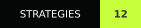
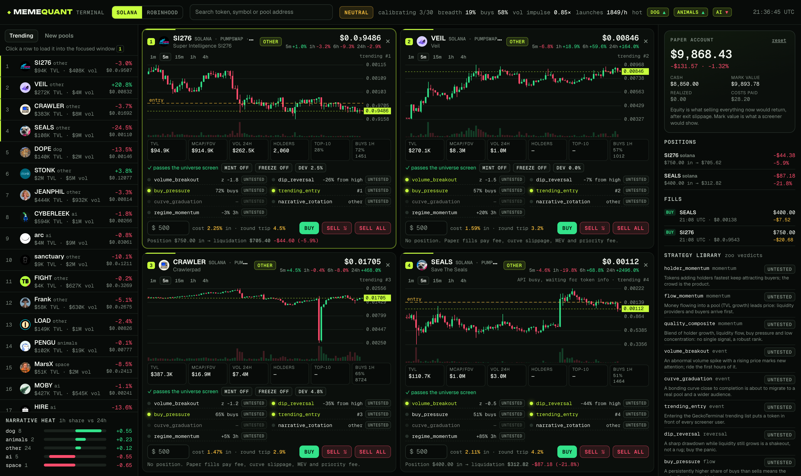
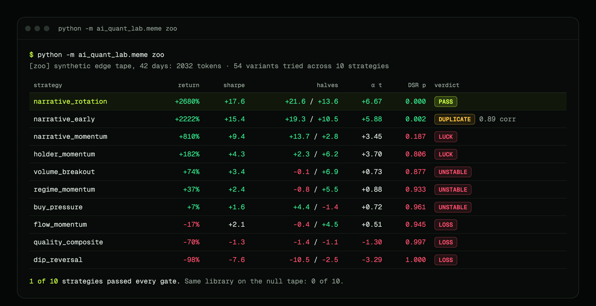

<p align="center">
  
</p>

<p align="center">
  <a href="https://github.com/zostaff/quant-memcoins-researcher/actions/workflows/ci.yml"></a>
  
  
  
  <a href="LICENSE"></a>
</p>
<p align="center">
  
  
  
</p>

<p align="center">
  <b>The research stack a hedge fund would use, pointed at memecoins.</b><br>
  Claude invents strategies. The engine prices in rugs, curve slippage and MEV,<br>
  counts every variant you tried, and kills whatever was luck or market beta.<br>
  Ships with 12 strategies, narrative rotation and market-mood signals included,<br>
  and a four-window live terminal that shows what each of them reads on a token right now.
</p>

<p align="center">
  <a href="https://zostaff.github.io/quant-memcoins-researcher/"><b>Website</b></a> ·
  <a href="#-the-demo">Demo</a> ·
  <a href="#-the-terminal">Terminal</a> ·
  <a href="#-the-strategy-zoo">Strategy zoo</a> ·
  <a href="#-narratives-and-market-mood">Narratives</a> ·
  <a href="#-what-it-does">What it does</a> ·
  <a href="#-chains">Chains</a> ·
  <a href="#-quick-start">Quick start</a> ·
  <a href="#-how-it-works">How it works</a> ·
  <a href="docs/MEMECOIN.md">Docs</a>
</p>

<br>

## ⚡ The demo

**+127% in a backtest. Rejected anyway.**

<p align="center"></p>

Twenty strategy variants run on two synthetic tapes, no API key needed.

- **No edge in the tape:** all 20 lose money. The best one turns $2,000 into
  $265 after $1,655 of fees, price impact, MEV and priority fees.
- **A planted edge:** the best variant makes +126.8% with Sharpe 5.67, and the
  system still says no. The first half loses money, 0.29 of the return is
  meme-market beta, alpha is not significant, and the deflated Sharpe says
  the best of 20 random tries would look this good anyway.

The profit was the market, not the signal. That is the mistake this tool exists to catch.

```bash
python -m ai_quant_lab.meme demo      # about a minute
```

<br>

## 🖥️ The terminal

```bash
python -m ai_quant_lab.meme terminal --open        # http://127.0.0.1:8787
```

<p align="center"></p>

Four memecoins on one screen, live from GeckoTerminal and DexScreener on Solana and Robinhood Chain. Each window shows:

- **Chart and flow.** Candles from 1m to 4h, TVL, FDV, volume, holders, top-10 share, buy share of the last hour.
- **The universe screen.** The library's own filter: TVL, age, mint and freeze authority, top-10 concentration, honeypot. A token that fails it gets its signals shown as blocked.
- **What every strategy reads on it.** Volume breakout, dip reversal, buy pressure, trending entry, curve graduation, narrative rotation and regime momentum, asked about this one pool with the library's features and thresholds.
- **The zoo's verdict next to each signal.** `PASS`, `LUCK`, `LOSS` or `untested`, loaded from `zoo --json`. A lit signal from a strategy that never passed the zoo says so on the same line.
- **What the ticket really costs.** Fee, curve slippage on the pool's reserve, MEV and priority fee for the amount typed in, one way and round trip, before you click.

Around the windows sit a watchlist (trending and new pools), the market pulse (risk-on or risk-off from breadth, buy share, volume impulse and launch pace) and narrative heat.

**Paper trading** charges the backtest's execution costs on every fill. The account shows two values: what a screener would call it, and what selling everything now would actually return. The gap is the price of getting out.

```bash
python -m ai_quant_lab.meme zoo --db data/meme.db --json verdicts.json
python -m ai_quant_lab.meme terminal --verdicts verdicts.json --book paper.db
```

More in [TERMINAL.md](docs/TERMINAL.md).

<br>

## 🧪 The strategy zoo

**12 strategies, 54 variants, one honest trial count.**

<p align="center"></p>

The library covers what a memecoin desk tries first: holder and liquidity momentum,
volume breakouts, bonding-curve graduation, trending-list entries, dip buying, order-flow
imbalance, three narrative strategies and a regime-gated momentum. The zoo backtests
every variant, counts **all** of them as trials, and judges the best of each strategy.

- **Planted narrative edge, 42 days:** `narrative_rotation` passes every gate
  (alpha t +6.7, deflated Sharpe p 0.000, both halves positive). Its close relative
  is flagged as a 0.89-correlated duplicate. `narrative_momentum` makes +810% and is
  still rejected: the best of 54 tries looks that good by chance often enough.
- **Capacity is the catch:** even the survivor's return on capital halves between a
  $2,000 and a $10,000 book. Edges in fresh memecoin pools are real-money small.
- **Narratives visible but worthless:** 0 of 10 pass.
- **The same edge on 21 days:** nothing passes. Not enough history is a verdict too.

```bash
python -m ai_quant_lab.meme zoo --list                                  # the library
python -m ai_quant_lab.meme zoo                                         # edge tape, ~4 min
python -m ai_quant_lab.meme zoo --tape null                             # nothing should pass
python -m ai_quant_lab.meme zoo --db data/meme.db --network robinhood --out report.md
```

Full reports: [edge tape](docs/zoo/edge-tape.md) · [null tape](docs/zoo/null-tape.md) ·
strategy write-ups: [docs/STRATEGIES.md](docs/STRATEGIES.md)

<details>
<summary><b>Verdicts</b></summary>
<br>

| Verdict | Rule (first match wins) |
|---|---|
| `IDLE` | the entry signal never fired |
| `LOSS` | net return or Sharpe ≤ 0 after fees, slippage, MEV, priority fees and rugs |
| `UNSTABLE` | either half of the sample has a negative Sharpe |
| `BETA` | alpha t-stat < 2 while the meme factors explain R² ≥ 0.15 |
| `LUCK` | deflated Sharpe p ≥ 0.05 over every variant in the zoo |
| `THIN` | capacity below the book size tested |
| `DUPLICATE` | correlation > 0.6 with a strategy that already passed |
| `PASS` | survived everything: worth fresh data, not yet worth money |
</details>

<br>

## 🗞️ Narratives and market mood

Memecoins trade in stories, and attention rotates between them: AI agents one week,
dogs the next, politics around an election. The engine measures that point-in-time.

| Signal | What it measures |
|---|---|
| **Narrative label** | AI, politics, stocks, dogs, cats, frogs, celebrities, animals, anime, food, gaming, space, internet culture, read from the token's name and symbol |
| **Narrative heat** | a narrative's share of volume now versus its usual share |
| **Narrative return** | liquidity-weighted return of the narrative, rugs at −100% |
| **Launch saturation** | copycat launches versus the usual pace: is the theme crowded? |
| **Risk appetite** | breadth, launch rate, death rate, volume impulse, buy pressure and curve progress, z-scored on trailing history |
| **External sentiment** | any feed (X mentions, LunarCrush, Kaito, your own model) aligned with a publication lag |

Labels come from names and symbols because those are fixed on chain at launch.
GeckoTerminal's categories are stored too, but never used as labels: they are assigned
after the fact, often after the token already ran, and labelling history with them is
look-ahead bias. The trending list is recorded for pools already in the universe and never
adds pools to it: picking pools because they trend is picking them on their outcome.

<br>

## 🛡️ For allocators: what is tested, not promised

| Claim | Where it is enforced |
|---|---|
| No strategy sees the future | for every library strategy, weights on a panel cut at two dates must equal the full-sample weights bar for bar ([`tests/test_strategies.py`](tests/test_strategies.py)) |
| Narrative and mood features are point-in-time | the same truncation test on heat, returns, saturation, mood and risk appetite |
| Every variant counts | the zoo's trial count is the number of variants run; the deflated Sharpe of every strategy uses it |
| Dead tokens stay dead | panel loader tests: a pool that goes quiet or loses its reserve never comes back |
| The null tape is rejected | the zoo test runs the library on a tape with no edge and requires no `PASS` |
| Synthetic switches do not leak | turning narratives on never changes base-tape prices (tested) |
| External sentiment is lagged | a score is usable only after its publication lag (tested) |

193 tests run on every push to `main` (Python 3.11 and 3.12, ruff).

<br>

## 🧬 What it does

Every tool a fund uses to stop fooling itself, rebuilt for a market where most tokens die within a day.

| | Memecoin backtests usually… | Here instead |
|:--:|---|---|
| 🪦 | test only tokens that are alive today | **Point-in-time universe.** Pools are recorded the moment they launch; dead tokens stay in the panel and a rug while held is written off to zero |
| 💧 | guess slippage at a flat 1% | **Exact curve cost.** Constant-product loss `1 - (1-f)·Q/(Q+s)` per trade, plus priority fee, MEV haircut and the real Uniswap fee tier of each pool |
| 🐋 | trade size the pool cannot absorb | **Participation cap.** A position is at most 2% of pool TVL; the book rebalances only past a 25% drift |
| 📈 | call +120% alpha | **Alpha vs beta.** Meme factors MKT, SIZE, MOM, AGE and FLOW, rugs included, and an OLS split of signal vs market |
| 🏦 | assume it scales | **Capacity curve.** The same weights at $1k, $10k, $100k and $1M; capacity is where return on capital halves |
| 🎰 | keep the best of 50 tries | **Deflated Sharpe.** Every variant is written to SQLite, and significance is paid for with the honest trial count |
| 🚩 | ignore who holds the supply | **Rug screen.** Holders, top-10 wallet share, developer share, mint and freeze authority, honeypot flag, bonding-curve progress, all point-in-time |
| 🗞️ | ignore what story is selling | **Narratives.** Each token's theme, the theme's heat, return and crowding, plus a market-wide risk-appetite score |

Everything ends in one **tear sheet**: costs broken down, factor betas, capacity, both halves, deflated Sharpe, and a verdict.


<br>

## ⛓️ Chains

| |  |  |
|---|---|---|
| **Venues** | pump.fun, PumpSwap, Meteora | Uniswap v4 / v3, Pons, Bankr |
| **Pool fee** | 1% default | read from each pool's fee tier: 1%, 0.3%, 0.01% |
| **Per-transaction cost** | priority fee + tip | L2 gas in ETH |
| **MEV** | sandwiches are common | sequencer, no public mempool |
| **Token fields** | holders, top-10, mint / freeze, curve progress | holders, top-10, Pons curve progress |

Data comes from the free GeckoTerminal API, and one database holds both chains.
Cost presets are placeholders: calibrate them on your own fills.

<br>

## 🚀 Quick start

```bash
git clone https://github.com/zostaff/quant-memcoins-researcher
cd quant-memcoins-researcher
python3 -m venv .venv && source .venv/bin/activate
pip install -e ".[dev]"
cp .env.example .env          # ANTHROPIC_API_KEY, only needed for `research`
```

```bash
python -m ai_quant_lab.meme demo                        # tear sheets, no key, no data
python -m ai_quant_lab.meme run  --db data/meme.db      # collect Solana + Robinhood Chain, keep running
python -m ai_quant_lab.meme info --db data/meme.db      # what has been collected
python -m ai_quant_lab.meme zoo  --db data/meme.db      # run the strategy library on it
python -m ai_quant_lab.meme terminal --open             # four live windows, signals, paper trading
python -m ai_quant_lab.meme research --db data/meme.db --network robinhood --iterations 20
```

| Command | |
|---|---|
| `demo` | Tear sheets on synthetic tapes, no API key or data needed |
| `collect` | Register new pools and snapshot the tracked ones |
| `backfill` | Pull 5-minute candles for collected pools |
| `run` | Collect and refresh the stalest candles on every chain, forever |
| `info` | Pools, candles, token fields and the narrative mix per chain |
| `zoo` | Run the strategy library through every gate and write a report |
| `research` | Claude proposes strategies on the collected panel; the gates decide |
| `terminal` | Four-window live terminal: signals with zoo verdicts, real trade costs, paper book |

> [!NOTE]
> The free API allows about 30 calls a minute, so the collector needs to run for
> days before there is history worth researching. A launchd template is in [`deploy/`](deploy/).

<br>

## 🔬 How it works

<p align="center"></p>

1. **Hypothesis.** Claude proposes a signal from volume and holder growth, liquidity, age, curve progress, buy pressure, narrative heat and crowding, market risk appetite and the rug screen.
2. **Critic.** A second Claude call attacks the idea before any compute is spent.
3. **Sandbox.** Generated code is AST-checked and runs with numpy, pandas and the feature library only.
4. **Backtest.** Long-only on the point-in-time panel with curve costs, the participation cap, the rebalance band and rug write-offs.
5. **Gates.** Deflated Sharpe over the honest trial count, then correlation and PCA checks against the strategies already accepted. No overrides.
6. **Tear sheet.** Meme-factor betas, capacity, both halves, verdict.

```python
from ai_quant_lab.meme import MemeBacktestConfig, costs_for_network, meme_backtest, tear_sheet

config = MemeBacktestConfig(costs=costs_for_network("robinhood"))
result = meme_backtest(weights, panel, config)          # long-only, rugs written off
sheet = tear_sheet(weights, panel, n_trials=memory.n_trials(), config=config)
print(sheet.summary())
```

Default model is Claude Opus 5.5, with prompt caching on the agents' system prompts.

<br>

## 🧱 The engine underneath

The memecoin layer ([`ai_quant_lab/meme/`](ai_quant_lab/meme/), about 3,000 lines)
sits on a general research engine that does not care which market it points at.

<details>
<summary><b>Deflated Sharpe and the multiple-testing tax</b></summary>
<br>


Run a thousand random strategies on a tape with no edge and the best one shows
an annualized Sharpe around 1.5. "We tried many things and the best one works"
means nothing until it is paid for with the trial count.
`examples/05_deflated_sharpe_demo.py` shows the gate killing the lucky best.
Methodology: [docs/VALIDATION.md](docs/VALIDATION.md).
</details>

<details>
<summary><b>Leakage detector, walk-forward and purged CV</b></summary>
<br>


Centered rolling windows, forgotten shifts and forward-looking labels used as
features are caught by comparing future and past correlations of every feature
with the target. Walk-forward and combinatorial purged CV give a distribution of
out-of-sample Sharpes instead of one lucky number.
</details>

<details>
<summary><b>Correlation and PCA gates, factor attribution, kill switch</b></summary>
<br>

A new strategy must not be a quiet copy of one already accepted: pairwise
correlation and PCA concentration both check for that. Accepted strategies get a
paper-trading slot with live diagnostics against the backtest distribution and a
kill switch on drawdown, daily loss and Sharpe collapse, which stays tripped
until reset by hand.
</details>

| Example | What it shows | Key |
|---|---|:--:|
| [`11_strategy_zoo.py`](examples/11_strategy_zoo.py) | Strategy library on a narrative tape, verdict per strategy | — |
| [`10_memecoin_multiple_testing.py`](examples/10_memecoin_multiple_testing.py) | Memecoin panel, many variants, the gate decides | — |
| [`05_deflated_sharpe_demo.py`](examples/05_deflated_sharpe_demo.py) | 1000 random strategies, the deflated Sharpe kills the best | — |
| [`03_leakage_demo.py`](examples/03_leakage_demo.py) | Forward reference vs centered rolling vs clean | — |
| [`09_cross_sectional_portfolio.py`](examples/09_cross_sectional_portfolio.py) | PCA gate finds duplication pairwise correlation misses | — |
| [`06_full_research_loop.py`](examples/06_full_research_loop.py) | End-to-end Claude loop | 🔑 |

<br>

## 🚧 What it does not do

- **It does not trade real money.** No wallet, no execution. The terminal trades on paper with the same cost model; the engine tells you whether a strategy is worth trading.
- **A lit signal is not advice.** Most library strategies have not passed the zoo on real data; the terminal shows each verdict next to its signal for that reason.
- **Costs are a model.** Constant product is exact for bonding curves and conservative for concentrated liquidity. Calibrate against real fills.
- **Free data has gaps.** Holder counts arrive late for fresh tokens, and GeckoTerminal does not report mint or freeze authority on EVM chains.
- **No social data out of the box.** Narratives are read from names and on-chain activity; X or news sentiment needs your own feed through `load_external_sentiment`.
- **Synthetic results are a test of the process,** not a forecast. They show the gates pass a real edge with enough history and kill a fake one.
- **History has to be collected.** The panel only knows what the collector saw, from the moment it started.

<br>

## 📚 Docs

| | |
|---|---|
| [MEMECOIN.md](docs/MEMECOIN.md) | The memecoin layer, chains, data fields |
| [TERMINAL.md](docs/TERMINAL.md) | The live terminal: windows, signals, costs, paper trading, API |
| [STRATEGIES.md](docs/STRATEGIES.md) | Strategy library, narratives, market mood, external sentiment, the zoo |
| [ARCHITECTURE.md](docs/ARCHITECTURE.md) | System design |
| [AGENTS.md](docs/AGENTS.md) | Agent prompts and behavior |
| [VALIDATION.md](docs/VALIDATION.md) | Statistical methodology |
| [CONTRIBUTING.md](docs/CONTRIBUTING.md) | Extending the system |

Built on [ai-quant-researcher](https://github.com/zostaff/ai-quant-researcher).

<br>

<p align="center">
  <b>Build slow. Validate hard. Trade small.</b><br>
  <sub>MIT licensed. Not investment advice. Memecoins go to zero; so can you.</sub>
</p>
